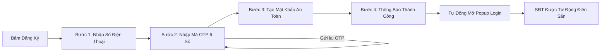

# 🥮 Nguyệt Phố B2B - Sàn Giao Dịch Bánh Trung Thu Luxury (Frontend)

> **Cổng phân phối & đấu thầu quà tặng Trung Thu Doanh nghiệp hàng đầu Việt Nam.**  
> Kết nối trực tiếp các đơn vị thu mua số lượng lớn với 50+ xưởng bánh nghệ nhân và thương hiệu uy tín, chuẩn hóa hợp đồng điện tử e-Contract, thanh toán ký quỹ SafeTrade Escrow và bàn giao vận chuyển PoD xe lạnh toàn quốc.

---

## 📑 Mục Lục
1. [Kiến Trúc Mã Nguồn Chuẩn Doanh Nghiệp (Project Architecture)](#-kiến-trúc-mã-nguồn-chuẩn-doanh-nghiệp)
2. [Công Nghệ Sử Dụng (Tech Stack)](#-công-nghệ-sử-dụng)
3. [🎨 QUY ĐỊNH BẮT BUỘC: PHÁT TRIỂN GIAO DIỆN VỚI ANT DESIGN](#-quy-định-bắt-buộc-phát-triển-giao-diện-với-ant-design)
4. [Cấu Hình Môi Trường (.env & Backend API)](#-cấu-hình-môi-trường-env--backend-api)
5. [Hướng Dẫn Cài Đặt & Khởi Chạy (Quick Start)](#-hướng-dẫn-cài-đặt--khởi-chạy)
6. [Các Phân Hệ Chức Năng Chính (Modules & Features)](#-các-phân-hệ-chức-năng-chính)
7. [Quy Trình Xác Thực & Đăng Ký OTP (Auth Flow)](#-quy-trình-xác-thực--đăng-ký-otp)
8. [Tiêu Chuẩn Lập Trình & Quy Ước (Conventions)](#-tiêu-chuẩn-lập-trình--quy-ước)

---

## 🏛️ Kiến Trúc Mã Nguồn Chuẩn Doanh Nghiệp

Mã nguồn frontend được tổ chức theo mô hình **Layered Architecture (Kiến trúc phân tầng)**, phân tách rành mạch giữa Giao diện (Presentation), Xử lý dịch vụ (Services / API), Trạng thái toàn cục (State / Context), Tiện ích (Utils) và Hằng số hệ thống (Constants):

```text
mooncake-fe/
├── .agents/                     # CẤU HÌNH & QUY TẮC AGENT CODING CHUẨN (Antigravity System)
│   ├── AGENTS.md                # Quy tắc cốt lõi: Tab size 2, chuẩn format JS, kiến trúc phân tầng, BẮT BUỘC Ant Design
│   ├── rules/                   # Bộ quy tắc chi tiết:
│   │   ├── react-architecture.md     # Quy tắc kiến trúc React & Bảng mapping component Ant Design
│   │   ├── code-formatting.md        # Quy tắc format 2 spaces, dấu nháy kép JSX, Ant Design props
│   │   ├── javascript-standards.md   # Chuẩn ES2024+, thứ tự import (React -> antd -> icons -> custom)
│   │   ├── api-guidelines.md         # Chuẩn Axios apiClient tập trung, timeout 15s, mock fallback
│   │   └── security-and-quality.md   # Kiểm soát bảo mật token, build 0 lỗi & rà soát tuân thủ Ant Design
│   └── skills/                  # Kỹ năng tự động hóa Agent:
│       ├── component-generator/      # Scaffolding component React chuẩn Ant Design (Card, Button, Tag, Space)
│       └── service-generator/        # Scaffolding API Service tích hợp apiClient và Mock Fallback
├── .editorconfig                # Cấu hình IDE đồng bộ tab size 2 (2 spaces), UTF-8, LF
├── .prettierrc                  # Cấu hình Prettier tự động format chuẩn JS/JSX
├── .env.example                 # Mẫu biến môi trường (Backend API, Port, Timeout, OAuth)
├── .env                         # Biến môi trường local development (được gitignore bảo mật)
├── package.json                 # Danh sách thư viện phụ thuộc và scripts
├── vite.config.js               # Cấu hình Vite bundler & React plugin
└── src/
    ├── main.jsx                 # Entry point khởi tạo React root, ConfigProvider (Ant Design) & AuthProvider
    ├── index.css                # Global CSS, Micro-animations (Shimmer, Glow, Marquee)
    ├── App.jsx                  # Root Component, Quản lý điều hướng (Router) và các Modal toàn cục
    │
    ├── theme/                   # HỆ THỐNG GIAO DIỆN & DESIGN TOKENS (Design System)
    │   └── antdTheme.js         # ConfigProvider Theme Ant Design tập trung (Crimson Luxury #8c1524, Gold #d48806)
    │
    ├── constants/               # HẰNG SỐ HỆ THỐNG (Constants Layer)
    │   ├── apiEndpoints.js      # Mapping tập trung toàn bộ endpoint API của Backend ASP.NET Core
    │   ├── routes.js            # Khóa định danh trang (Navigation Keys) & danh sách Route Aliases
    │   └── roles.js             # Phân quyền (Customer, Supplier, Admin) và trạng thái đơn hàng/Escrow
    │
    ├── services/                # TẦNG DỊCH VỤ & GỌI API (Services / API Layer)
    │   ├── apiClient.js         # Axios Client tập trung (Interceptors, Bearer JWT, Timeout 15s, Mapping lỗi)
    │   ├── authService.js       # Nghiệp vụ Đăng nhập, Đăng ký, Gửi/Xác thực OTP, Google OAuth
    │   └── productService.js    # Nghiệp vụ Lấy danh mục sản phẩm, tìm kiếm, lọc & bánh nổi bật
    │
    ├── context/                 # QUẢN LÝ TRẠNG THÁI TOÀN CỤC (Context State Layer)
    │   └── AuthContext.jsx      # Quản lý phiên đăng nhập, Token JWT, dữ liệu User & đồng bộ LocalStorage
    │
    ├── hooks/                   # CUSTOM REACT HOOKS
    │   ├── useAuth.js           # Hook truy xuất nhanh thông tin đăng nhập và quyền hạn
    │   └── useDebounce.js       # Hook tối ưu debounce cho ô tìm kiếm sản phẩm theo thời gian thực
    │
    ├── utils/                   # HÀM TIỆN ÍCH (Utilities Layer)
    │   ├── formatters.js        # Format tiền tệ VNĐ (480.000 ₫), ngày tháng, định dạng số điện thoại
    │   ├── validators.js        # Kiểm tra tính hợp lệ của SĐT di động Việt Nam, mật khẩu, email, MST
    │   └── storage.js           # Wrapper an toàn cho LocalStorage tránh crash khi lưu trữ JSON
    │
    ├── components/              # GIAO DIỆN DÙNG CHUNG (Reusable Components)
    │   └── layout/              # Hệ thống khung bố cục chuẩn hóa
    │       ├── AppLogo.jsx            # Logo thương hiệu vector SVG & nhãn typography hoàng gia
    │       ├── CustomerHeader.jsx     # Header cổng Khách hàng (Search pill, Danh mục, Giỏ hàng, Thông báo)
    │       ├── CustomerFooter.jsx     # Footer cổng Khách hàng 4 cột (Trust Bar, Cam kết Escrow, Hotline)
    │       └── ColonyAdminLayout.jsx  # Layout chuẩn Colony Admin cho phân hệ Quản trị & Nhà cung cấp
    │
    └── Pages/                   # PHÂN HỆ CÁC TRANG CHỨC NĂNG (Pages / Views)
        ├── HomePage.jsx         # Trang chủ (Hero background lễ hội, Card xưởng bánh nghệ nhân, Danh mục)
        ├── SearchPage.jsx       # Trang tìm kiếm, lọc theo mức chiết khấu, hương vị, xưởng sản xuất
        ├── Notification.jsx     # Trung tâm thông báo B2B
        ├── LoginPopup.jsx       # Modal điều phối Đăng nhập & Quên mật khẩu
        ├── RegisterPopup.jsx    # Modal điều phối Đăng ký 3 bước chuẩn UX xác thực số điện thoại
        │
        ├── Auth/                # Quy trình xác thực tách biệt theo từng bước (Sub-steps)
        │   ├── LoginForm.jsx             # Form nhập SĐT, mật khẩu, Ghi nhớ, Đăng nhập Google
        │   ├── ForgotPasswordForm.jsx    # Form khôi phục mật khẩu qua mã OTP SMS
        │   ├── RegisterPhoneStep.jsx     # Bước 1: Nhập số điện thoại đăng ký
        │   ├── RegisterOtpStep.jsx       # Bước 2: Nhập và đếm ngược OTP 6 số
        │   ├── RegisterPasswordStep.jsx  # Bước 3: Thiết lập mật khẩu bảo mật
        │   ├── RegisterSuccessStep.jsx   # Bước 4: Thông báo thành công & chuyển sang Đăng nhập
        │   └── GoogleCallbackPage.jsx    # Màn hình xử lý OAuth callback với Ant Design Result & Spin
        │
        ├── Customer/            # Phân hệ Dành cho Khách hàng Thu mua Doanh nghiệp
        │   ├── CustomerProfile.jsx            # Hồ sơ doanh nghiệp & Hạn mức thanh toán
        │   ├── OrderAndDesgin.jsx             # Đặt hàng thiết kế & Giỏ quà tặng
        │   ├── PackagingAndLogoPrinting.jsx   # Dịch vụ gia công ép kim & In logo nhận diện
        │   ├── BiddingAndQuoteComparison.jsx  # So sánh bảng chào giá thầu RFQ từ các xưởng
        │   ├── ContractsAndMilestone.jsx      # Ký số e-Contract & Theo dõi tiến độ hợp đồng
        │   ├── DeliveryPoD.jsx                # Theo dõi giao hàng xe lạnh & Bàn giao PoD
        │   └── PaymentAndRate.jsx             # Ký quỹ Escrow, Xuất VAT & Nghiệm thu chất lượng
        │
        ├── Supplier/            # Phân hệ Dành cho Nhà sản xuất & Xưởng làm bánh (Colony Admin Layout)
        │   ├── StoreSetUp.jsx                 # Đăng ký & Thiết lập gian hàng B2B
        │   ├── ProductManage.jsx              # Quản lý danh mục & Kiểm định an toàn thực phẩm
        │   ├── BiddingPage.jsx                # Nộp hồ sơ chào giá đơn hàng lớn (Bulk Bidding)
        │   ├── OrderManage.jsx                # Quản lý đơn đặt hàng sỉ
        │   ├── ContractManage.jsx             # Quản lý hợp đồng cung ứng
        │   ├── DeliverManage.jsx              # Điều phối logistics & Xuất kho
        │   └── SuppilerProfile.jsx            # Hồ sơ năng lực & Chứng nhận ISO/HACCP
        │
        ├── Admin/               # Phân hệ Quản trị Sàn Giao dịch (Admin Portal - Colony Admin Layout)
        │   ├── DashBoard.jsx                  # Bảng số liệu thống kê doanh số & GMV toàn sàn
        │   ├── ApprovePage.jsx                # Phê duyệt hồ sơ xưởng sản xuất & Giám định ATTP
        │   ├── TradingOperating.jsx           # Giám sát giao dịch ký quỹ Escrow
        │   ├── ControllerPage.jsx             # Kiểm soát rủi ro & Giải quyết khiếu nại
        │   ├── SystemControll.jsx             # Cấu hình phí sàn, tỷ lệ ký quỹ & hệ thống
        │   └── AdminProfile.jsx               # Thông tin quản trị viên
        │
        └── Products/
            └── ProductInformation.jsx         # Chi tiết hộp bánh, định lượng & bậc chiết khấu sỉ
```

---

## 🚀 Công Nghệ Sử Dụng

- **Frontend Core:** [React 19](https://react.dev/) + [Vite 8](https://vitejs.dev/) (Tối ưu Fast HMR & Build siêu tốc).
- **UI Framework Bắt Buộc:** [Ant Design 5.x (`antd`)](https://ant.design/) - Thư viện giao diện doanh nghiệp chuẩn hóa.
- **Icon System:** [@ant-design/icons](https://ant.design/components/icon/) - Bộ icon đồng bộ và giàu tính biểu đạt.
- **Theme & Design Tokens:** `src/theme/antdTheme.js` (Tùy biến bảng màu hoàng gia Đỏ rượu `#8c1524`, Vàng kim `#d48806`, Nền ấm `#faf8f6`).
- **Khung Bố Cục Quản Trị:** Template **Colony Admin Layout** (`src/components/layout/ColonyAdminLayout.jsx`) dành cho phân hệ Admin & Supplier.
- **Khung Bố Cục Khách Hàng:** `CustomerHeader.jsx` & `CustomerFooter.jsx` + `AppLogo.jsx`.
- **HTTP Client:** [Axios](https://axios-http.com/) (Interceptors tự động nạp Bearer JWT, xử lý Timeout 15s & mapping lỗi ASP.NET Core).
- **Styling Phụ Trợ:** [Tailwind CSS](https://tailwindcss.com/) cho tiện ích căn lề và bố cục đáp ứng (responsive).
- **Typography:** Google Fonts (`Playfair Display` phong cách cung đình nghệ nhân & `Be Vietnam Pro` chuẩn đọc tiếng Việt).
- **Backend Architecture:** RESTful API chuẩn Clean Architecture ASP.NET Core 8.

---

## 🎨 QUY ĐỊNH BẮT BUỘC: PHÁT TRIỂN GIAO DIỆN VỚI ANT DESIGN

> [!IMPORTANT]
> **QUY TẮC BẮT BUỘC CHO MỌI LẬP TRÌNH VIÊN & AI AGENT:**  
> Khi viết mã thêm tính năng UI mới, tạo màn hình mới, refactor component hoặc sửa đổi giao diện, **BẮT BUỘC 100% PHẢI SỬ DỤNG CÁC UI COMPONENT CỦA ANT DESIGN (`antd`) VÀ ICON TỪ `@ant-design/icons`**.  
> **TUYỆT ĐỐI CẤM** tự viết các thẻ HTML trần cho tương tác như `<button>`, `<input>`, `<select>`, `<dialog>`, `<table>`.

### 1. Bảng Ánh Xạ Bắt Buộc (Component Mapping Table)

| Thành phần UI cần hiển thị | Component Ant Design Bắt Buộc | Tuyệt đối KHÔNG sử dụng |
| :--- | :--- | :--- |
| **Nút bấm, hành động** | `<Button type="primary / default / link" icon={<... />} />` | `<button>` HTML trần |
| **Ô nhập liệu văn bản, tìm kiếm** | `<Input />`, `<Input.Password />`, `<Input.Search />` | `<input type="text/password">` |
| **Hộp chọn danh sách** | `<Select options={...} />` | `<select>`, `<option>` |
| **Cửa sổ bật lên (Popup, Modal)** | `<Modal open={...} onCancel={...} footer={...}>` | `<dialog>`, modal tự dựng bằng `div` |
| **Thẻ sản phẩm, xưởng, bài viết** | `<Card hoverable cover={}>` | `<div>` tự code card |
| **Bảng dữ liệu danh sách** | `<Table columns={...} dataSource={...} pagination={...} />` | `<table>`, `<tr>`, `<td>` thô |
| **Các bước quy trình (Step Wizard)** | `<Steps items={...} current={...} />` | Stepper tự vẽ thủ công |
| **Thẻ nhãn, tag phân loại** | `<Tag color="gold / red / green">...</Tag>` | `<span>` gắn class màu |
| **Huy hiệu, số lượng thông báo** | `<Badge count={...} />` | `<span>` vẽ số đỏ |
| **Vòng xoay tải trang (Loading)** | `<Spin indicator={...} spinning={...} />` | Spinner CSS tự chế |
| **Cảnh báo, thông báo ngữ cảnh** | `<Alert message="..." type="warning / error / info" />` | Alert box tự code |
| **Màn hình thông báo kết quả** | `<Result status="success / error / 404" ... />` | Màn hình kết quả tự vẽ |
| **Thẻ số liệu thống kê, KPI** | `<Statistic title="..." value={...} prefix={<... />} />` | Div thống kê thô |
| **Thực đơn thả xuống (Menu/Dropdown)** | `<Dropdown menu={{ items }} />` | Dropdown toggle tự chế |
| **Bố cục lưới hàng / cột** | `<Row gutter={[16, 16]}><Col span={...}>` | Div float hoặc grid thô |
| **Khoảng cách linh hoạt giữa phần tử** | `<Space direction="horizontal / vertical" size="...">` | Margin chắp vá |
| **Kiểu chữ & Tiêu đề** | `<Typography.Title level={...}>`, `<Typography.Text>` | `<h1>`..`<h6>`, `<p>` không đồng bộ |

### 2. Quy Chuẩn Bố Cục (Layout Standards)
- **Phân hệ Khách hàng (Customer & Public):** Bắt buộc tích hợp `CustomerHeader.jsx` và `CustomerFooter.jsx` từ thư mục `src/components/layout/`.
- **Phân hệ Quản trị (Admin) & Nhà cung cấp (Supplier):** Bắt buộc sử dụng khung mẫu **Colony Admin Layout** (`src/components/layout/ColonyAdminLayout.jsx`) đã có sẵn Sidebar, Header thống kê và Breadcrumb.

### 3. Ví Dụ Mẫu Triển Khai Component Chuẩn Ant Design

```jsx
import { useState } from 'react';
import { Card, Button, Tag, Typography, Space, Modal } from 'antd';
import { ShopOutlined, CheckCircleFilled, ArrowRightOutlined } from '@ant-design/icons';
import { formatCurrency } from '../../utils/formatters';

const { Title, Text, Paragraph } = Typography;

export default function SupplierCard({ supplier, onSelect }) {
  const [isOpenModal, setIsOpenModal] = useState(false);

  return (
    <>
      <Card
        hoverable
        bordered={false}
        style={{ borderRadius: 14, overflow: 'hidden', border: '1px solid #ebdcd5' }}
        cover={
          
        }
        actions={[
          <Button
            type="primary"
            block
            icon={<ShopOutlined />}
            onClick={() => setIsOpenModal(true)}
            style={{ background: '#8c1524', borderColor: '#8c1524', fontWeight: 600 }}
          >
            Xem Năng Lực Cung Ứng
          </Button>,
        ]}
      >
        <Space orientation="horizontal" orientationMargin={0} style={{ marginBottom: 8 }}>
          <Tag color="gold" style={{ fontWeight: 700 }}>
            <CheckCircleFilled style={{ marginRight: 4 }} />
            Đã Kiểm Định ATTP
          </Tag>
        </Space>

        <Title level={4} style={{ margin: '0 0 6px', color: '#1f1f1f' }}>
          {supplier?.name}
        </Title>
        <Paragraph ellipsis={{ rows: 2 }} style={{ color: '#666', fontSize: 13, marginBottom: 8 }}>
          {supplier?.description}
        </Paragraph>
        <Text style={{ color: '#8c1524', fontWeight: 700, fontSize: 15 }}>
          Từ {formatCurrency(supplier?.minOrderValue || 0)}
        </Text>
      </Card>

      <Modal
        title={`Hồ Sơ Năng Lực: ${supplier?.name}`}
        open={isOpenModal}
        onCancel={() => setIsOpenModal(false)}
        footer={[
          <Button key="close" onClick={() => setIsOpenModal(false)}>
            Đóng
          </Button>,
          <Button
            key="contact"
            type="primary"
            icon={<ArrowRightOutlined />}
            style={{ background: '#8c1524', borderColor: '#8c1524' }}
            onClick={() => onSelect?.(supplier)}
          >
            Yêu Cầu Báo Giá (RFQ)
          </Button>,
        ]}
      >
        <Paragraph>Nội dung chi tiết về quy mô nhà xưởng và chứng nhận chất lượng.</Paragraph>
      </Modal>
    </>
  );
}
```

---

## ⚙️ Cấu Hình Môi Trường (.env & Backend API)

Dự án frontend kết nối trực tiếp với backend **ASP.NET Core 8 Web API** (`Mooncake.EcommercePlatform.WebApi`).

### 1. Tạo file cấu hình môi trường
Sao chép file `.env.example` thành `.env`:
```bash
cp .env.example .env
```

### 2. Các biến môi trường chính trong `.env`:
| Biến môi trường | Ý nghĩa | Giá trị mặc định (Local Dev) |
| :--- | :--- | :--- |
| `VITE_API_BASE_URL` | Địa chỉ gốc của Backend API ASP.NET Core | `http://localhost:5043/api` *(hoặc `https://localhost:7256/api`)* |
| `VITE_API_VERSION` | Phiên bản API | `v1` |
| `VITE_API_TIMEOUT` | Thời gian timeout yêu cầu (ms) | `15000` (15 giây) |
| `VITE_ENABLE_MOCK_FALLBACK` | Tự động trả mock data nếu Backend chưa bật | `true` (Hỗ trợ code UI độc lập) |
| `VITE_GOOGLE_CLIENT_ID` | Client ID cho tính năng Google Social Login | `your-google-client-id.apps.googleusercontent.com` |

---

## 🛠️ Hướng Dẫn Cài Đặt & Khởi Chạy

### Yêu cầu hệ thống:
- **Node.js:** `>= 18.0.0` (Khuyên dùng Node 20 LTS)
- **NPM:** `>= 9.0.0`

### Các bước khởi chạy:

1. **Cài đặt thư viện dependencies:**
   ```bash
   npm install
   ```

2. **Khởi chạy Development Server:**
   ```bash
   npm run dev
   ```
   > Ứng dụng sẽ chạy tại địa chỉ: **`http://localhost:5173/`**

3. **Kiểm tra mã nguồn & ESLint:**
   ```bash
   npm run lint
   ```

4. **Đóng gói Production Bundle:**
   ```bash
   npm run build
   ```
   > Đảm bảo biên dịch thành công 0 lỗi. Sản phẩm build tối ưu sẽ được lưu tại thư mục `dist/`.

---

## 📦 Các Phân Hệ Chức Năng Chính

### 1. Cổng Doanh Nghiệp Thu Mua (Corporate Buyer Portal)
- Xem bảng chiết khấu bậc thang theo số lượng (chiết khấu lên tới 35%).
- Đăng thầu yêu cầu báo giá (**RFQ**) và nhận 3–5 bản chào giá cạnh tranh từ các xưởng.
- Dịch vụ in ép kim, khắc laser logo thương hiệu lên hộp bánh VIP.
- Hợp đồng điện tử xác thực (**e-Contract**) và hóa đơn điện tử VAT xuất trong ngày.

### 2. Cổng Nhà Sản Xuất & Xưởng Bánh (Supplier Portal - Colony Admin)
- Đăng ký mở gian hàng B2B, kiểm duyệt chứng chỉ an toàn thực phẩm ISO 22000 & HACCP.
- Quản lý kho hàng, định lượng và nhận đơn đặt hàng số lượng lớn.
- Nộp hồ sơ chào giá đấu thầu cung ứng mùa Trung Thu.

### 3. Cổng Quản Trị Hệ Thống (Admin Portal - Colony Admin)
- Giám định và phê duyệt hồ sơ năng lực xưởng làm bánh.
- Quản lý dòng tiền thanh toán ký quỹ bảo chứng (**SafeTrade Escrow**): Tiền chỉ giải ngân khi khách hàng doanh nghiệp ký biên bản nghiệm thu đạt chất lượng.
- Báo cáo GMV và điều phối đơn hàng khẩn cấp.

---

## 🔐 Quy Trình Xác Thực & Đăng Ký OTP (Auth Flow)

Flow UI đăng ký tài khoản được thiết kế chuẩn xác thực số điện thoại hiện đại:



1. **Bước 1 (Nhập SĐT):** Người dùng nhập số điện thoại di động hợp lệ (10 số).
2. **Bước 2 (Xác thực OTP):** Nhập mã OTP 6 số gửi qua tin nhắn SMS, tích hợp đếm ngược 60 giây và nút *Gửi lại mã OTP*.
3. **Bước 3 (Thiết lập mật khẩu):** Nhập mật khẩu mới & xác nhận mật khẩu (sử dụng `<Input.Password />`).
4. **Bước 4 (Đồng bộ Login):** Chuyển mượt về màn hình Đăng nhập với số điện thoại đã được điền sẵn kèm thông báo xác nhận thành công.

---

## 📐 Tiêu Chuẩn Lập Trình & Quy Ước (Conventions)

1. **Agent Coding & Code Generation Standards (.agents/):**
   - **Thụt lề bắt buộc:** Tab size = 2 (2 spaces), không dùng hard tab (`\t`), kết thúc file bằng dòng trống mới.
   - **Chuẩn format JS/JSX:** ES2024+, dấu chấm phẩy `;`, nháy đơn `'...'` cho JS, nháy kép `"..."` cho JSX attributes, `const`/`let` (không dùng `var`), optional chaining `?.`, nullish coalescing `??`.
   - **Bắt buộc Ant Design:** Mọi thành phần UI mới phải sử dụng `antd` & `@ant-design/icons`. Không viết thẻ HTML trần cho tương tác.
   - Xem chi tiết tại thư mục [.agents/](file:///.agents/AGENTS.md).
2. **Clean Code & Tách Biệt Trách Nhiệm:**
   - Không gọi `axios`/`fetch` trực tiếp trong component; luôn sử dụng các hàm nghiệp vụ trong `src/services/`.
   - Tất cả hằng số đường dẫn API nằm trong `src/constants/apiEndpoints.js`.
   - Định dạng tiền tệ và ngày tháng luôn dùng các hàm chuẩn trong `src/utils/formatters.js`.
3. **UI/UX Nhất Quán:**
   - Gam màu thương hiệu: Đỏ rượu hoàng gia (`#8c1524`), Vàng kim (`#d48806`, `#f5c840`), Nền ấm sang trọng (`#faf8f6`).
   - Tận dụng hệ thống theme tập trung tại `src/theme/antdTheme.js` và layout Colony Admin.
4. **Quản Lý Git:**
   - Tuân thủ commit message theo chuẩn [Conventional Commits](https://www.conventionalcommits.org/): `feat:`, `fix:`, `refactor:`, `docs:`, `chore:`.

---

© 2025 **Nguyệt Phố B2B**. Nền tảng phân phối Quà tặng Trung Thu Doanh Nghiệp uy tín.
