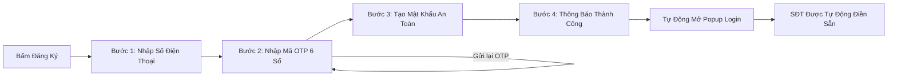

# 🥮 Nguyệt Phố B2B - Sàn Giao Dịch Bánh Trung Thu Luxury (Frontend)

> **Cổng phân phối & đấu thầu quà tặng Trung Thu Doanh nghiệp hàng đầu Việt Nam.**  
> Kết nối trực tiếp các đơn vị thu mua số lượng lớn với 50+ xưởng bánh nghệ nhân và thương hiệu uy tín, chuẩn hóa hợp đồng điện tử e-Contract, thanh toán ký quỹ SafeTrade Escrow và bàn giao vận chuyển PoD xe lạnh toàn quốc.

---

## 📑 Mục Lục
1. [Kiến Trúc Mã Nguồn Chuẩn Doanh Nghiệp (Project Architecture)](#-kiến-trúc-mã-nguồn-chuẩn-doanh-nghiệp)
2. [Công Nghệ Sử Dụng (Tech Stack)](#-công-nghệ-sử-dụng)
3. [Cấu Hình Môi Trường (.env & Backend API)](#-cấu-hình-môi-trường-env--backend-api)
4. [Hướng Dẫn Cài Đặt & Khởi Chạy (Quick Start)](#-hướng-dẫn-cài-đặt--khởi-chạy)
5. [Các Phân Hệ Chức Năng Chính (Modules & Features)](#-các-phân-hệ-chức-năng-chính)
6. [Quy Trình Xác Thực & Đăng Ký OTP (Auth Flow)](#-quy-trình-xác-thực--đăng-ký-otp)
7. [Tiêu Chuẩn Lập Trình & Quy Ước (Conventions)](#-tiêu-chuẩn-lập-trình--quy-ước)

---

## 🏛️ Kiến Trúc Mã Nguồn Chuẩn Doanh Nghiệp

Mã nguồn frontend được tổ chức theo mô hình **Layered Architecture (Kiến trúc phân tầng)**, phân tách rành mạch giữa Giao diện (Presentation), Xử lý dịch vụ (Services / API), Trạng thái toàn cục (State / Context), Tiện ích (Utils) và Hằng số hệ thống (Constants):

```text
mooncake-fe/
├── .agents/                     # CẤU HÌNH & QUY TẮC AGENT CODING CHUẨN (Antigravity System)
│   ├── AGENTS.md                # Quy tắc cốt lõi: Tab size 2, chuẩn format JS, kiến trúc phân tầng
│   ├── rules/                   # Bộ quy tắc chi tiết (Code format, JS standards, React 19, API Axios, Security)
│   └── skills/                  # Kỹ năng tự động hóa (component-generator, service-generator)
├── .editorconfig                # Cấu hình IDE đồng bộ tab size 2 (2 spaces), UTF-8, LF
├── .prettierrc                  # Cấu hình Prettier tự động format chuẩn JS/JSX
├── .prettierignore              # Bỏ qua dist, node_modules, .env
├── .env.example                 # Mẫu biến môi trường (Backend API, Port, Timeout, OAuth)
├── .env                         # Biến môi trường local development (được gitignore bảo mật)
├── .gitignore                   # Cấu hình bỏ qua file nhạy cảm và node_modules
├── index.html                   # HTML Entry point, nạp font & Tailwind CSS CDN
├── package.json                 # Danh sách thư viện phụ thuộc và scripts
├── vite.config.js               # Cấu hình Vite bundler & React plugin
└── src/
    ├── main.jsx                 # Entry point khởi tạo React root và AuthProvider
    ├── index.css                # Global CSS, Material Symbols, Micro-animations (Shimmer, Glow, Marquee)
    ├── App.jsx                  # Root Component, Quản lý điều hướng (Router) và các Modal toàn cục
    │
    ├── constants/               # HẰNG SỐ HỆ THỐNG (Constants Layer)
    │   ├── apiEndpoints.js      # Mapping tập trung toàn bộ endpoint API của Backend ASP.NET Core
    │   ├── routes.js            # Khóa định danh trang (Navigation Keys) & danh sách Route Aliases
    │   └── roles.js             # Phân quyền (Customer, Supplier, Admin) và trạng thái đơn hàng/Escrow
    │
    ├── services/                # TẦNG DỊCH VỤ & GỌI API (Services / API Layer)
    │   ├── apiClient.js         # Axios Client tập trung (Request/Response Interceptors, Bearer JWT, Timeout, Mapping lỗi)
    │   ├── authService.js       # Nghiệp vụ Đăng nhập, Đăng ký, Gửi/Xác thực OTP, Google OAuth
    │   └── productService.js    # Nghiệp vụ Lấy danh mục sản phẩm, tìm kiếm, lọc & bánh nổi bật
    │
    ├── context/                 # QUẢN LÝ TRẠNG THÁI TOÀN CỤC (Context State Layer)
    │   └── AuthContext.jsx      # Quản lý phiên đăng nhập, Token JWT, dữ liệu User & đồng bộ LocalStorage
    │
    ├── hooks/                   # CUSTOM REACT HOOKS
    │   ├── useAuth.js           # Hook truy xuất nhanh thông tin đăng nhập và quyền hạn
    │   └── useDebounce.js       # Hook tối ưu debounce cho ô tìm kiếm sản phẩm theo thời gian thực
    │
    ├── utils/                   # HÀM TIỆN ÍCH (Utilities Layer)
    │   ├── formatters.js        # Format tiền tệ VNĐ (480.000 ₫), ngày tháng, định dạng số điện thoại
    │   ├── validators.js        # Kiểm tra tính hợp lệ của SĐT di động Việt Nam, mật khẩu, email, MST
    │   └── storage.js           # Wrapper an toàn cho LocalStorage tránh crash khi lưu trữ JSON
    │
    ├── components/              # GIAO DIỆN DÙNG CHUNG (Reusable Components)
    │   ├── Header.jsx           # Thanh điều hướng Chợ Tốt Luxury (Search, Quản lý đơn, Avatar Menu, Drawer)
    │   └── Footer.jsx           # Chân trang chuẩn E-Commerce 4 cột (Trust Bar, VAT, Hotline 1800 6886, Escrow)
    │
    └── Pages/                   # PHÂN HỆ CÁC TRANG CHỨC NĂNG (Pages / Views)
        ├── HomePage.jsx         # Trang chủ (Banner Hero nghệ nhân, Logo Marquee, Bộ sưu tập tiêu biểu, Live Toast)
        ├── SearchPage.jsx       # Trang tìm kiếm, lọc theo mức chiết khấu, hương vị, xưởng sản xuất
        ├── Notification.jsx     # Trung tâm thông báo B2B
        ├── LoginPopup.jsx       # Modal Đăng nhập (SĐT, Password, Google OAuth, Ghi nhớ, Quên mật khẩu OTP)
        ├── RegisterPopup.jsx    # Modal Đăng ký 3 bước chuẩn UX (Nhập SĐT ➔ Xác nhận OTP ➔ Tạo mật khẩu)
        │
        ├── Customer/            # Phân hệ Dành cho Khách hàng Thu mua Doanh nghiệp
        │   ├── CustomerProfile.jsx            # Hồ sơ doanh nghiệp & Hạn mức thanh toán
        │   ├── OrderAndDesgin.jsx             # Đặt hàng thiết kế & Giỏ quà tặng
        │   ├── PackagingAndLogoPrinting.jsx   # Dịch vụ gia công ép kim & In logo nhận diện
        │   ├── BiddingAndQuoteComparison.jsx  # So sánh bảng chào giá thầu RFQ từ các xưởng
        │   ├── ContractsAndMilestone.jsx      # Ký số e-Contract & Theo dõi tiến độ hợp đồng
        │   ├── DeliveryPoD.jsx                # Theo dõi giao hàng xe lạnh & Bàn giao PoD
        │   └── PaymentAndRate.jsx             # Ký quỹ Escrow, Xuất VAT & Nghiệm thu chất lượng
        │
        ├── Supplier/            # Phân hệ Dành cho Nhà sản xuất & Xưởng làm bánh
        │   ├── StoreSetUp.jsx                 # Đăng ký & Thiết lập gian hàng B2B
        │   ├── ProductManage.jsx              # Quản lý danh mục & Kiểm định an toàn thực phẩm
        │   ├── BiddingPage.jsx                # Nộp hồ sơ chào giá đơn hàng lớn (Bulk Bidding)
        │   ├── OrderManage.jsx                # Quản lý đơn đặt hàng sỉ
        │   ├── ContractManage.jsx             # Quản lý hợp đồng cung ứng
        │   ├── DeliverManage.jsx              # Điều phối logistics & Xuất kho
        │   └── SuppilerProfile.jsx            # Hồ sơ năng lực & Chứng nhận ISO/HACCP
        │
        ├── Admin/               # Phân hệ Quản trị Sàn Giao dịch (Admin Portal)
        │   ├── DashBoard.jsx                  # Bảng số liệu thống kê doanh số & GMV toàn sàn
        │   ├── ApprovePage.jsx                # Phê duyệt hồ sơ xưởng sản xuất & Giám định ATTP
        │   ├── TradingOperating.jsx           # Giám sát giao dịch ký quỹ Escrow
        │   ├── ControllerPage.jsx             # Kiểm soát rủi ro & Giải quyết khiếu nại
        │   ├── SystemControll.jsx             # Cấu hình phí sàn, tỷ lệ ký quỹ & hệ thống
        │   └── AdminProfile.jsx               # Thông tin quản trị viên
        │
        └── Products/
            └── ProductInformation.jsx         # Chi tiết hộp bánh, định lượng & bậc chiết khấu sỉ
```

---

## 🚀 Công Nghệ Sử Dụng

- **Frontend Core:** [React 19](https://react.dev/) + [Vite 8](https://vitejs.dev/) (Tối ưu Fast HMR & Build siêu tốc).
- **HTTP Client:** [Axios](https://axios-http.com/) (Interceptors tự động nạp Bearer JWT, xử lý Timeout & mapping lỗi ASP.NET Core).
- **Styling & Design System:** [Tailwind CSS](https://tailwindcss.com/) + Custom HSL Luxury Tokens.
- **Iconography:** [Google Material Symbols Outlined](https://fonts.google.com/icons).
- **Typography:** Google Fonts (`Playfair Display` phong cách cung đình nghệ nhân & `Be Vietnam Pro` chuẩn đọc tiếng Việt).
- **Kiến trúc kết nối:** RESTful API chuẩn Clean Architecture ASP.NET Core 8.

---

## ⚙️ Cấu Hình Môi Trường (.env & Backend API)

Dự án frontend kết nối trực tiếp với backend **ASP.NET Core 8 Web API** (`Mooncake.EcommercePlatform.WebApi`).

### 1. Tạo file cấu hình môi trường
Sao chép file `.env.example` thành `.env`:
```bash
cp .env.example .env
```

### 2. Các biến môi trường chính trong `.env`:
| Biến môi trường | Ý nghĩa | Giá trị mặc định (Local Dev) |
| :--- | :--- | :--- |
| `VITE_API_BASE_URL` | Địa chỉ gốc của Backend API ASP.NET Core | `http://localhost:5043/api` *(hoặc `https://localhost:7256/api`)* |
| `VITE_API_VERSION` | Phiên bản API | `v1` |
| `VITE_API_TIMEOUT` | Thời gian timeout yêu cầu (ms) | `15000` (15 giây) |
| `VITE_ENABLE_MOCK_FALLBACK` | Tự động trả mock data nếu Backend chưa bật | `true` (Hỗ trợ code UI độc lập) |
| `VITE_GOOGLE_CLIENT_ID` | Client ID cho tính năng Google Social Login | `your-google-client-id.apps.googleusercontent.com` |

---

## 🛠️ Hướng Dẫn Cài Đặt & Khởi Chạy

### Yêu cầu hệ thống:
- **Node.js:** `>= 18.0.0` (Khuyên dùng Node 20 LTS)
- **NPM:** `>= 9.0.0`

### Các bước khởi chạy:

1. **Cài đặt thư viện dependencies:**
   ```bash
   npm install
   ```

2. **Khởi chạy Development Server:**
   ```bash
   npm run dev
   ```
   > Ứng dụng sẽ chạy tại địa chỉ: **`http://localhost:5173/`**

3. **Kiểm tra mã nguồn & ESLint:**
   ```bash
   npm run lint
   ```

4. **Đóng gói Production Bundle:**
   ```bash
   npm run build
   ```
   > Sản phẩm build tối ưu sẽ được lưu tại thư mục `dist/`.

---

## 📦 Các Phân Hệ Chức Năng Chính

### 1. Cổng Doanh Nghiệp Thu Mua (Corporate Buyer Portal)
- Xem bảng chiết khấu bậc thang theo số lượng (chiết khấu lên tới 35%).
- Đăng thầu yêu cầu báo giá (**RFQ**) và nhận 3–5 bản chào giá cạnh tranh từ các xưởng.
- Dịch vụ in ép kim, khắc laser logo thương hiệu lên hộp bánh VIP.
- Hợp đồng điện tử xác thực (**FPT.eContract**) và hóa đơn điện tử VAT xuất trong ngày.

### 2. Cổng Nhà Sản Xuất & Xưởng Bánh (Supplier Portal)
- Đăng ký mở gian hàng B2B, kiểm duyệt chứng chỉ an toàn thực phẩm ISO 22000 & HACCP.
- Quản lý kho hàng, định lượng và nhận đơn đặt hàng số lượng lớn.
- Nộp hồ sơ đấu thầu cung ứng mùa Trung Thu.

### 3. Cổng Quản Trị Hệ Thống (Admin Portal)
- Giám định và phê duyệt hồ sơ năng lực xưởng làm bánh.
- Quản lý dòng tiền thanh toán ký quỹ bảo chứng (**SafeTrade Escrow**): Tiền chỉ giải ngân khi khách hàng doanh nghiệp ký biên bản nghiệm thu đạt chất lượng.
- Báo cáo GMV và điều phối đơn hàng khẩn cấp.

---

## 🔐 Quy Trình Xác Thực & Đăng Ký OTP (Auth Flow)

Flow UI đăng ký tài khoản được thiết kế chuẩn xác thực số điện thoại hiện đại:



1. **Bước 1 (Nhập SĐT):** Người dùng nhập số điện thoại di động hợp lệ (10 số).
2. **Bước 2 (Xác thực OTP):** Nhập mã OTP 6 số gửi qua tin nhắn SMS, tích hợp đếm ngược 60 giây và nút *Gửi lại mã OTP*.
3. **Bước 3 (Thiết lập mật khẩu):** Nhập mật khẩu mới & xác nhận mật khẩu (có nút xem/ẩn mật khẩu).
4. **Bước 4 (Đồng bộ Login):** Chuyển mượt về màn hình Đăng nhập với số điện thoại đã được điền sẵn kèm thông báo xác nhận thành công.

---

## 📐 Tiêu Chuẩn Lập Trình & Quy Ước (Conventions)

1. **Agent Coding & Code Generation Standards (.agents/):**
   - **Thụt lề bắt buộc:** Tab size = 2 (2 spaces), không dùng hard tab (`\t`), kết thúc file bằng dòng trống mới.
   - **Chuẩn format JS/JSX:** ES2024+, dấu chấm phẩy `;`, nháy đơn `'...'` cho JS, nháy kép `"..."` cho JSX attributes, `const`/`let` (không dùng `var`), optional chaining `?.`, nullish coalescing `??`.
   - Xem chi tiết tại thư mục [.agents/](file:///Users/admin/Desktop/PRN232/mooncake-fe/.agents/AGENTS.md).
2. **Clean Code & Tách Biệt Trách Nhiệm:**
   - Không gọi `axios`/`fetch` trực tiếp trong component; luôn sử dụng các hàm nghiệp vụ trong `src/services/`.
   - Tất cả hằng số đường dẫn API nằm trong `src/constants/apiEndpoints.js`.
   - Định dạng tiền tệ và ngày tháng luôn dùng các hàm chuẩn trong `src/utils/formatters.js`.
3. **UI/UX Nhất Quán:**
   - Gam màu thương hiệu: Đỏ thẫm hoàng gia (`primary: #7a0010`), Vàng hổ phách (`secondary: #ffba00` / `#fec971`), Nền ngà kem sang trọng (`surface: #fff8f5`).
   - Sử dụng các micro-animation tinh tế (`animate-shimmer`, `animate-pulse-glow`, `animate-marquee`) để tăng tính tương tác mà không gây rối mắt.
4. **Quản Lý Git:**
   - Tuân thủ commit message theo chuẩn [Conventional Commits](https://www.conventionalcommits.org/): `feat:`, `fix:`, `refactor:`, `docs:`, `chore:`.

---

© 2025 **Nguyệt Phố B2B**. Nền tảng phân phối Quà tặng Trung Thu Doanh Nghiệp uy tín.
